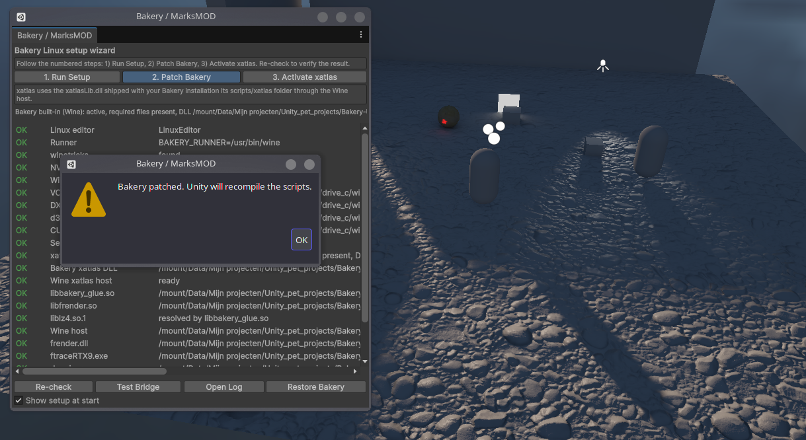
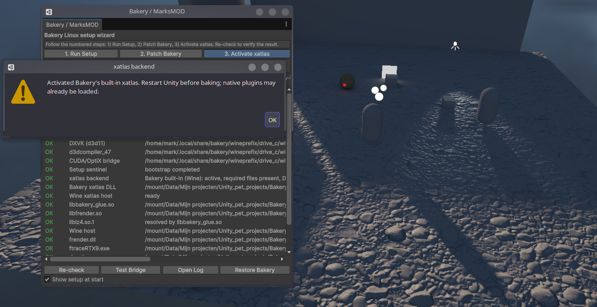
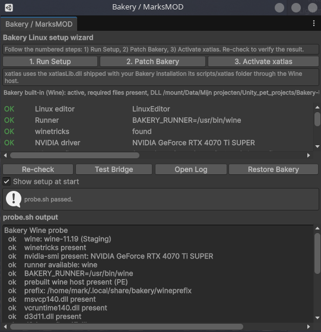
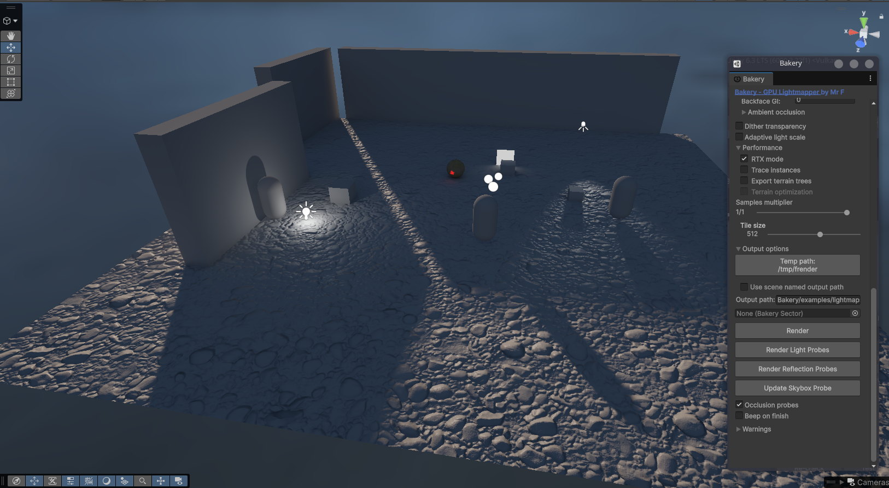
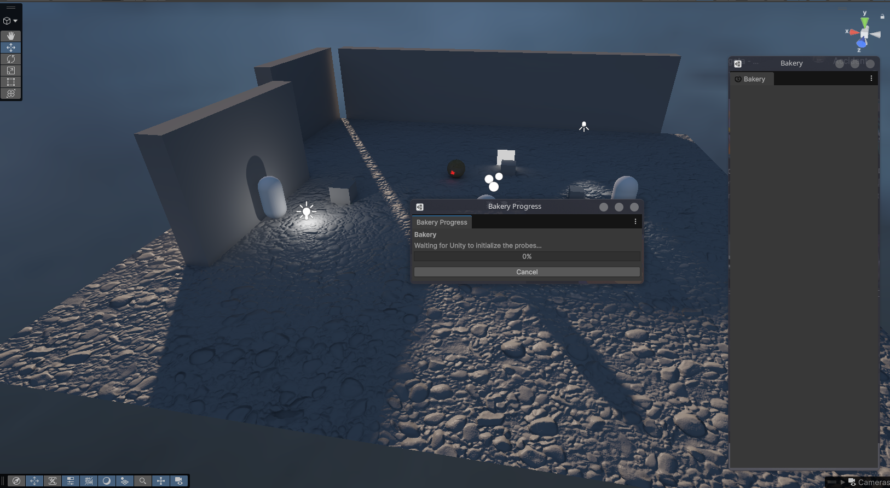
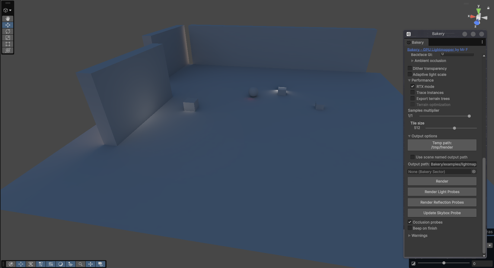

# MarksMOD - Bakery Linux compatibility layer

Version: 1.1.0

MarksMOD adds a Linux/Wine compatibility layer to an existing Bakery installation. It does not contain Bakery itself and does not include Bakery addon files.

## Requirements

- Linux editor with Unity (tested with 6000.3.22f1 and URP 17.3).
- NVIDIA GPU and driver for CUDA/OptiX.
- Wine (tested with 11.17) and winetricks.
- An existing Bakery installation in the project.

## Install

1. Copy `MarksMOD/Assets/*` into your Unity project's `Assets/` folder. This merges the `MarksMOD` folder and the Linux plugin shims.
2. Open `Bakery > MarksMOD > Setup Wizard`.
3. Click `1. Run Setup` once to prepare the Wine prefix, VC runtime, DXVK and NVIDIA libraries.
4. Click `2. Patch Bakery`. The patcher edits your own Bakery scripts in place and stores pristine backups under `MarksMOD/Native/backup~`.
5. Click `3. Activate xatlas` to install Bakery's xatlas proxy, then restart Unity.
6. Use `Re-check` and `Test Bridge` to validate the environment.

`Restore Bakery` reverts the patched Bakery scripts from the stored backups.

The current patcher version is 17 and targets eight Bakery files.

## Tested scope

The tested path is Linux + NVIDIA + URP + RTX9 (ftraceRTX9). The test suite covers full lighting, indirect, shadowmask, distance shadowmask, subtractive, AO-only, directional modes, light types, volumes, sectors, prefabs, transparency, denoisers (OptiX 7, OIDN v1/v2), light/reflection probes, cache reuse, cancel/re-bake, runtime lightmap apply, patcher apply/restore, Bakery's xatlas, xatlas atlas packing, xatlas unwrapping, multi-atlas/implicit groups, explicit single-atlas ownership, two-level LOD groups, and source isolation.

## xatlas

xatlas uses the `xatlasLib.dll` shipped with the user's Bakery installation through the Wine host. The active `libxatlasLib.so` is the ABI proxy; there is no separate native xatlas build. Pack, unwrap, multi-atlas, explicit single-atlas, and default regression tests pass through Bakery's own implementation. The Wine path uses a persistent host with readiness pings, serialized startup/shutdown, and TCP_NODELAY for practical IPC throughput. Use **Activate** in the setup wizard if the proxy is not active, then restart Unity before baking because native plugins may already be loaded.

Two-level LOD groups are tested. Very large meshes and the 32-bit index guard are not covered on this Unity version. Explicit groups intentionally produce one atlas; multi-atlas coverage uses implicit groups.

## Known limitations

- The TEMP path must be ASCII. Non-ASCII TEMP paths fail inside the vendor `uvGBufferGen` scene loader. Non-ASCII output paths work.
- The Bakery updater (`ExtractZIP`) is not implemented.
- OptiX 5 and OptiX 6 denoiser selections are mapped to OptiX 7 on Linux because the legacy denoisers are not supported by the Wine bridge. OptiX 7, OIDN v1 and OIDN v2 run natively through their normal backends.
- ECS, terrain, skinned meshes, APV and probe-SH directional mode have no test fixtures and are not claimed as supported. APV was not tested.
- The assembled-prefab example is not bakeable by design; use the prefab bake test path.
- Interactive progress and wizard behavior were verified in a GUI editor session. Batchmode progress reporting is suppressed.
- The Built-in render pipeline is out of scope; the tested pipeline is URP.
- Pixel-level Windows-vs-Linux parity was verified for the tested scenes; re-check new scenes after driver or Bakery changes.

## Notes

- The prebuilt `bakery_wine_host.exe` under `MarksMOD/Native/dist~/bin` is required at runtime; the setup wizard does not build it. It is a Windows helper launched through your system Wine (`/usr/bin/wine` by default), which is why Wine must be installed separately.
- The Linux plugin shims are provided under `Assets/Plugins/x86_64`.
- D3D11 tools (seamfixer, denoisers, buffer generators) are launched through Wine with explicit DXVK DLL overrides and the configured Wine prefix.
- The Wine host starts with the editor and stays available for import-time xatlas work; it shuts down when the editor quits.
- Bakery UI is left native: use Bakery's Experimental settings for the global Atlas Packer and the Lightmap Group asset inspector for per-group overrides.
- Do not redistribute the Bakery addon or its native payload. Users must install Bakery themselves.

## Screenshots

Bakery menu entry and the MarksMOD setup wizard:

Baking in the test scene:

[Wizard walkthrough (WebM, 3.8 s)](docs/images/wizard-walkthrough.webm)

Tested system:

