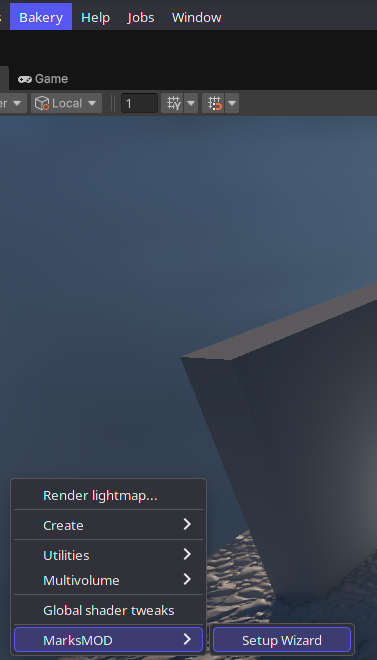
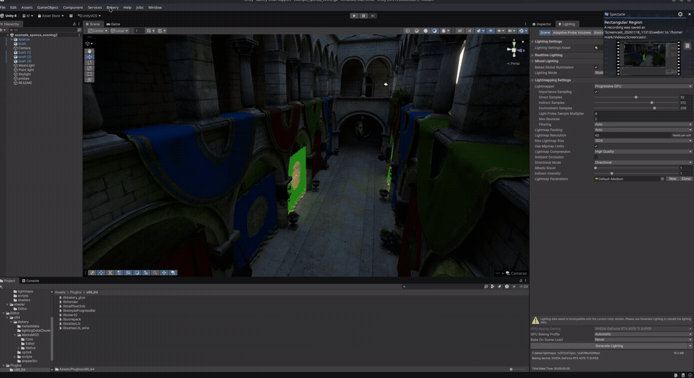
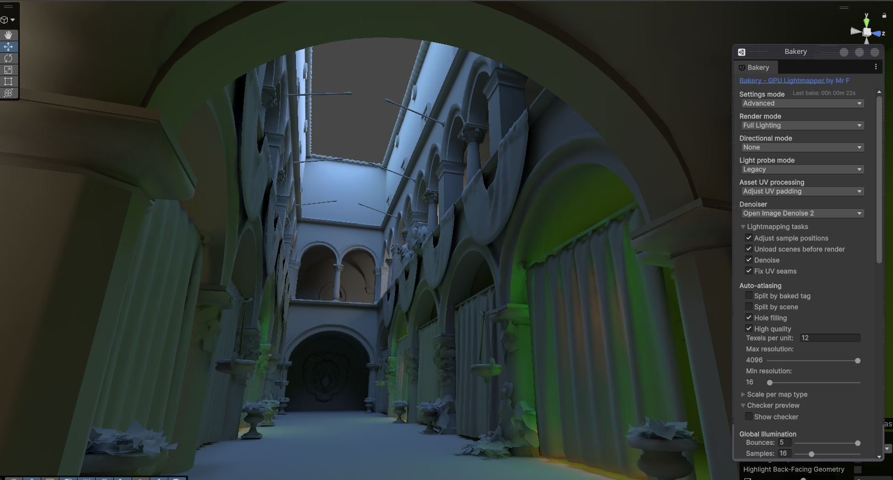
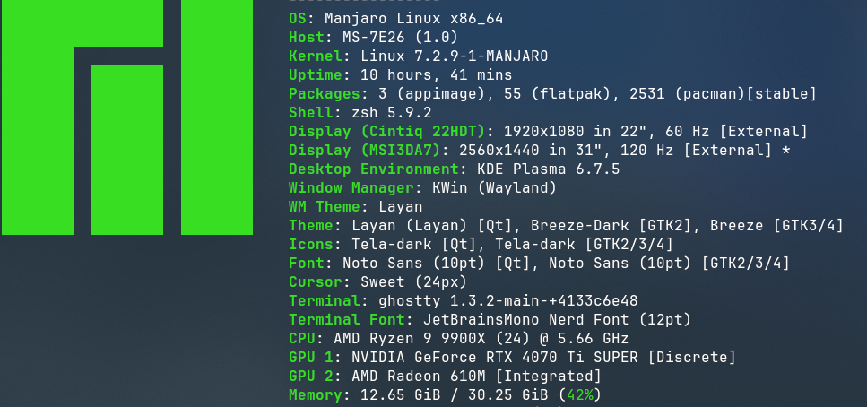

# MarksMOD - Bakery Linux compatibility layer

Version: 1.1.0

MarksMOD is a Linux/Wine compatibility layer for an existing Bakery installation. It does not contain Bakery or any of its files.

## Requirements

- Unity Editor on Linux (tested with Unity 6000.3.22f1 and URP 17.3).
- NVIDIA GPU and a driver that supports CUDA and OptiX.
- Wine (tested with wine-11.19) and winetricks, installed through your distribution's package manager.
- glibc, libstdc++ and liblz4 compatible with the shipped plugin shims. `PATCH!` reports the exact glibc requirement of the binaries.
- The `main` and `legacy-glibc` branches contain identical code; only the prebuilt Linux shims differ. `main` targets newer glibc, `legacy-glibc` targets an older baseline. Check `ldd --version` or the glibc row in `PATCH!` and use the matching branch.
- `/bin/bash`, `python3`, `flock`, `curl` or `wget`, and `tar` for the setup/probe scripts.
- Bakery v1.985 installed in your Unity project before merging MarksMOD. The patcher is source-anchored to this version; other Bakery versions report missing files or patch anchors. See the [MarksMOD README](https://github.com/MarkDuisters/MarksMOD?tab=readme-ov-file) for details.

## Install

1. Merge this repository's `Assets/` folder into your Unity project's `Assets/` folder. This adds the Linux plugin shims under `Assets/Plugins/x86_64` and places the add-on at `Assets/Editor/x64/Bakery/MarksMOD` when Bakery uses its default path. If Bakery is installed elsewhere, place the mentioned folders relative to the custom Bakery location instead.
2. Open `Bakery > MarksMOD > Setup Wizard`.
3. Click `PATCH!`. It checks the system requirements, runs Wine setup when the prefix is missing or incomplete, then patches Bakery. The patcher edits your installed Bakery files in place and stores pristine backups under `Assets/Editor/x64/Bakery/MarksMOD/Native/backup~`.
4. Click `Activate xatlas` to install Bakery's xatlas proxy, then restart Unity.
5. Use `Re-check` and `Test Bridge` to validate the setup.

`Restore Bakery` restores the original Bakery files from the stored backups and removes the `MarksMOD` folder from Bakery. The Linux plugin shims in `Assets/Plugins` are kept.

The current patcher version is 18 and targets seven Bakery files.

## Tested scope

The tested configuration is Linux with an NVIDIA GPU, URP and RTX9 (`ftraceRTX9`).

Validation covered:

- Bake modes: full lighting, indirect, shadowmask, distance shadowmask, subtractive, AO-only and directional modes.
- Scene features: light types, volumes, sectors, prefabs, transparency, light probes and reflection probes.
- Workflows: cache reuse, cancel and re-bake, runtime lightmap apply, and patcher apply/restore.
- Denoisers: OptiX 7, OIDN v1 and OIDN v2.
- xatlas: Bakery's xatlas, atlas packing, unwrapping, multi-atlas and implicit groups, explicit single-atlas ownership, and two-level LOD groups.
- Source isolation: bakes are checked for unintended changes to source scenes and their assets.

## xatlas

Bakery's xatlas backend runs Bakery's own `xatlasLib.dll` through the Wine host. The active `libxatlasLib.so` is the ABI proxy; there is no separate native xatlas build. The pack, unwrap, multi-atlas, explicit single-atlas and default regression tests all pass using Bakery's own implementation. The Wine path uses a persistent host with readiness pings, serialized startup and shutdown, and TCP_NODELAY for practical IPC throughput. Use `Activate xatlas` in the setup wizard if the proxy is not active, then restart Unity before baking because native plugins may already be loaded.

Two-level LOD groups are tested. Very large meshes and the 32-bit index guard are not covered on this Unity version. Explicit groups intentionally produce one atlas; multi-atlas coverage uses implicit groups.

## Known limitations

- The `TEMP` environment variable must point to a path that contains only ASCII characters. Non-ASCII `TEMP` paths fail inside the vendor `uvGBufferGen` scene loader. Output paths may contain non-ASCII characters.
- The in-editor Bakery updater (`ExtractZIP`) is not implemented.
- OptiX 5 and OptiX 6 denoiser selections are mapped to OptiX 7 on Linux because the legacy denoisers are not supported by the Wine bridge. OptiX 7, OIDN v1 and OIDN v2 run through their normal backends.
- ECS, terrain, skinned meshes, APV and probe-SH directional mode have no test fixtures and are not claimed as supported.
- The assembled-prefab example is not bakeable by design; bake prefab assets through Bakery's prefab workflow instead.
- Interactive progress and wizard behavior were verified in a GUI editor session. Batchmode runs do not report progress.
- The Built-in render pipeline is out of scope; the tested pipeline is URP.
- Pixel-level parity between Windows and Linux was verified for the tested scenes; re-check new scenes after driver or Bakery changes.

## Notes

- The first setup run (`PATCH!` when the Wine prefix is missing or incomplete) needs network access to download the winetricks components and the NVIDIA CUDA/OptiX libraries. `winetricks` must be on the `PATH` of the Unity process; copies bundled by Lutris or other launchers are not visible to Unity. `PATCH!` reports this.
- The prebuilt `bakery_wine_host.exe` under `Assets/Editor/x64/Bakery/MarksMOD/Native/dist~/bin` is required; the setup wizard does not build it. It is a Windows helper launched through your system Wine (`/usr/bin/wine` by default), so Wine must be installed separately.
- The Linux plugin shims are provided under `Assets/Plugins/x86_64`.
- D3D11 tools (seamfixer, denoisers, buffer generators) are launched through Wine with explicit DXVK DLL overrides and the configured Wine prefix.
- The Wine host starts with the editor and stays available for import-time xatlas work. It shuts down when the editor quits.
- Bakery's UI is unchanged: use Bakery's Experimental settings for the global Atlas Packer and the Lightmap Group asset inspector for per-group overrides.
- Do not redistribute the Bakery addon or its native payload. Users must install Bakery themselves.

## License

MarksMOD is licensed under the GNU General Public License v3.0. See [LICENSE](LICENSE). Bakery itself is not included and remains under its own license.

## Screenshots

Bakery menu entry and the MarksMOD setup wizard:

Baking in the test scene:

Tested system:

